# Cocina Capital

App Android que conecta a personas de la Región de Valparaíso con promociones de restaurantes locales. Los locales publican descuentos para sus horas de baja demanda y la app se los muestra a cada comprador ordenados según su perfil de consumo, la distancia y el descuento. El comprador canjea el beneficio gratis y recibe un voucher con código QR que muestra en el local.

Proyecto de la asignatura DSY1105 (Desarrollo de Aplicaciones Móviles, Duoc UC), hecho para el cliente COCINA CAPITAL, una pyme que hace de intermediaria entre consumidores y locales gastronómicos.

Integrantes: Joaquín Sánchez y Antonella Guzmán.

<p>
  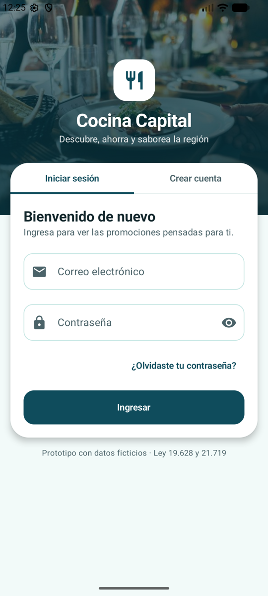
  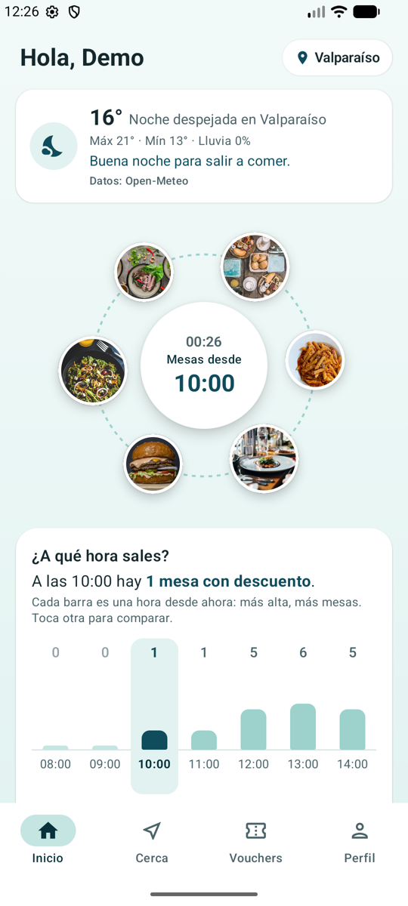
  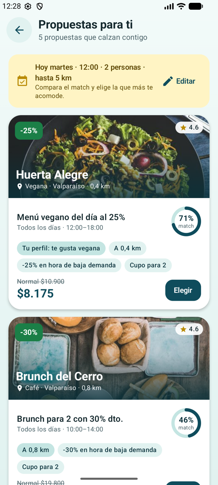
  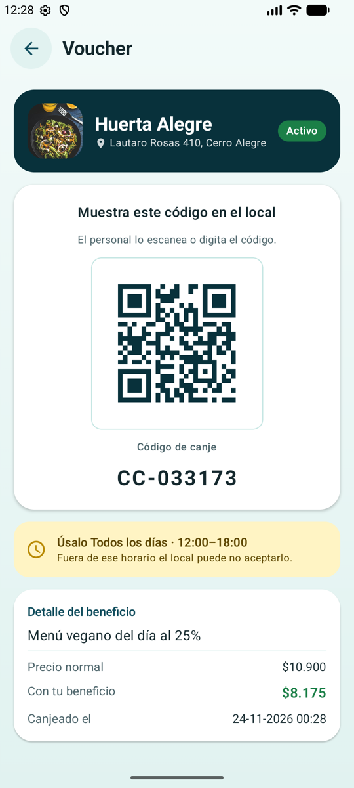
</p>

## Contexto

Muchos restaurantes de la región tienen horarios con las mesas vacías (la tarde de un martes, por ejemplo) y no tienen cómo avisarle a la gente que en ese momento les conviene ir. Cocina Capital les da un lugar donde publicar promociones solo para esas horas, y al comprador le muestra las que calzan con lo que busca.

La app tiene tres tipos de cuenta:

| Rol | Qué puede hacer |
|---|---|
| Comprador | Ver promociones ordenadas para él, buscar por día, hora, cantidad de personas y distancia, canjear beneficios y ver sus vouchers |
| Local | Editar el perfil de su restaurante y crear, editar, pausar o eliminar sus promociones |
| Administrador | Crear las cuentas de local, activarlas o desactivarlas y restablecer su contraseña |

Solo el administrador crea cuentas de local. Así cada restaurante pasa por una verificación y nadie puede registrarse por su cuenta para publicar promociones falsas.

Todos los datos del prototipo son ficticios, como exigen la Ley 19.628 y la Ley 21.719 de protección de datos personales.

### Cómo se calcula el % de match

Al armar una salida, el comprador elige día, hora, cuántas personas son, la categoría (opcional) y hasta qué distancia está dispuesto a ir. Primero se descartan las promociones que no sirven: las que no son válidas ese día u hora, las que no aceptan grupos de ese tamaño y las que quedan fuera del radio. Las que pasan suman puntos:

| Criterio | Puntos |
|---|---|
| Categoría pedida | 40 (20 si no eligió categoría) |
| Afinidad con su perfil de consumo | hasta 25 |
| Cercanía | hasta 20 |
| Descuento | hasta 15 |

El resultado queda entre 1 % y 99 %. La distancia se calcula con la fórmula de Haversine. El perfil de consumo sube 1 punto en una categoría cada vez que el comprador revisa un local de esa categoría, y 3 puntos cuando canjea. El cálculo está en [`data/Recomendador.kt`](app/src/main/java/cl/dsy1105/cocinacapital/data/Recomendador.kt).

## Arquitectura

```
App Android (Kotlin + Compose)
 ├── Room (base local en el teléfono)
 ├── Retrofit ──> Microservicio usuarios     :8081 ──> H2 (data/usuarios)
 ├── Retrofit ──> Microservicio promociones  :8082 ──> H2 (data/promociones)
 └── Retrofit ──> Open-Meteo (API externa de clima)
```

La app sigue el patrón MVVM y trabaja offline-first: guarda todo en Room y lo sincroniza con los microservicios cuando hay conexión. Si el servidor no responde, la app sigue funcionando con los datos locales.

## Consumo de API externa: Open-Meteo

La tarjeta del clima en la pantalla de inicio usa [Open-Meteo](https://open-meteo.com), una API de pronóstico gratuita que no pide clave. La app consulta:

```
GET https://api.open-meteo.com/v1/forecast
    ?latitude=-33.05&longitude=-71.62
    &current=temperature_2m,weather_code,is_day
    &daily=temperature_2m_max,temperature_2m_min,precipitation_probability_max
    &timezone=America/Santiago&forecast_days=1
```

Con la respuesta muestra la temperatura actual, la máxima y la mínima, la probabilidad de lluvia y una sugerencia para salir a comer según el tiempo. El código de clima (estándar WMO) se traduce a un texto como "Noche despejada" o "Lluvia".

| Archivo | Qué hace |
|---|---|
| [`data/remote/ClimaApi.kt`](app/src/main/java/cl/dsy1105/cocinacapital/data/remote/ClimaApi.kt) | Interfaz Retrofit y cliente HTTP |
| [`data/Clima.kt`](app/src/main/java/cl/dsy1105/cocinacapital/data/Clima.kt) | Convierte la respuesta en un modelo de la app y traduce el código de clima |
| [`viewmodel/ClimaViewModel.kt`](app/src/main/java/cl/dsy1105/cocinacapital/viewmodel/ClimaViewModel.kt) | Pide el clima en segundo plano (corrutinas) y expone el estado: cargando, listo o error |
| [`ui/components/TarjetaClima.kt`](app/src/main/java/cl/dsy1105/cocinacapital/ui/components/TarjetaClima.kt) | La tarjeta que se ve en el inicio |

Si no hay internet, la tarjeta no aparece y el resto de la app sigue igual.

## Microservicios propios en Spring Boot

El backend está en [`backend/`](backend/) y son dos microservicios independientes, cada uno con su propia base de datos:

| Microservicio | Puerto | Qué maneja |
|---|---|---|
| `usuarios` | 8081 | Cuentas de comprador, local y administrador, login con contraseñas cifradas con BCrypt y el perfil de cada restaurante |
| `promociones` | 8082 | Promociones de los locales, canjes de beneficios y perfil de consumo de cada comprador |

Usan Spring Boot 4.1, Spring Data JPA y H2 guardada en archivo, así que no hay que instalar una base de datos. Cada servicio tiene documentación interactiva con Swagger (springdoc) y valida los datos que recibe: si falta un campo o viene mal, responde con el error de cada campo.

La app los consume con Retrofit desde [`data/remote/CocinaApi.kt`](app/src/main/java/cl/dsy1105/cocinacapital/data/remote/CocinaApi.kt). Desde el emulador, el computador se ve en la dirección `10.0.2.2`, por eso la app apunta a `http://10.0.2.2:8081` y `http://10.0.2.2:8082`.

### Endpoints principales

usuarios (8081):

| Método | Ruta | Qué hace |
|---|---|---|
| POST | `/api/auth/registro` | Crea una cuenta de comprador (409 si el correo ya existe) |
| POST | `/api/auth/login` | Inicia sesión (401 si los datos no calzan, 403 si el local está desactivado) |
| GET | `/api/usuarios/{email}` | Datos de una cuenta |
| PUT | `/api/usuarios/{email}` | Edita nombre y foto |
| PUT | `/api/usuarios/{email}/clave` | Cambia la contraseña |
| GET | `/api/usuarios/locales` | Locales con su restaurante (panel del administrador) |
| POST | `/api/usuarios/locales` | El administrador crea un local |
| PATCH | `/api/usuarios/{email}/activo` | Activa o desactiva un local |
| GET / PUT | `/api/restaurantes/{email}` | Perfil del restaurante |

promociones (8082):

| Método | Ruta | Qué hace |
|---|---|---|
| GET | `/api/promociones` | Catálogo (`?vendedor=` para un local, `?activas=true` para las visibles) |
| POST | `/api/promociones` | Publica una promoción |
| PUT | `/api/promociones/{id}` | Edita una promoción |
| PATCH | `/api/promociones/{id}/estado` | Pausa o reactiva |
| DELETE | `/api/promociones/{id}` | Elimina |
| GET | `/api/canjes?usuario=` | Vouchers de un comprador |
| POST | `/api/canjes` | Canjea un beneficio (409 si ya lo canjeó) |
| GET | `/api/preferencias?usuario=` | Perfil de consumo de un comprador |

La lista completa está en [`backend/README.md`](backend/README.md) y en Swagger.

<p>
  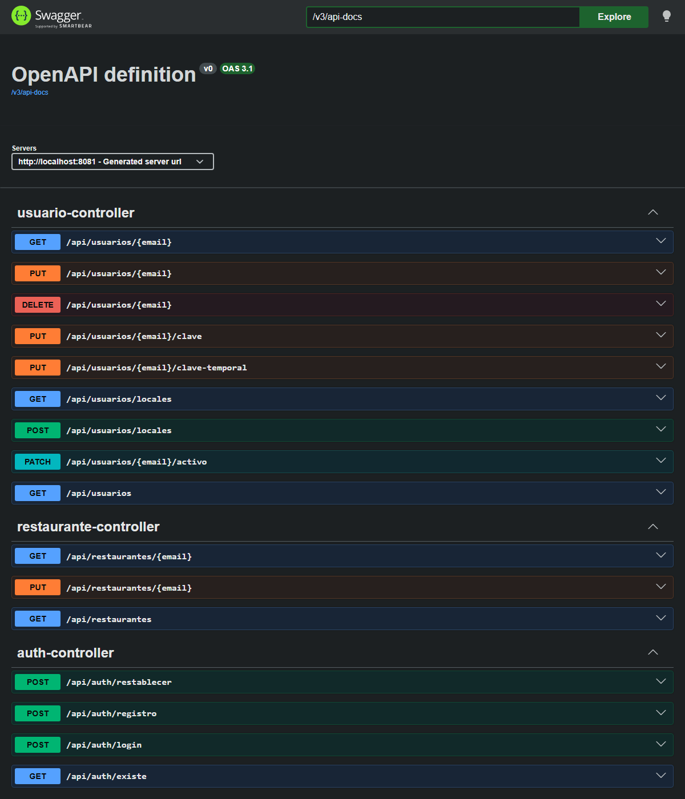
  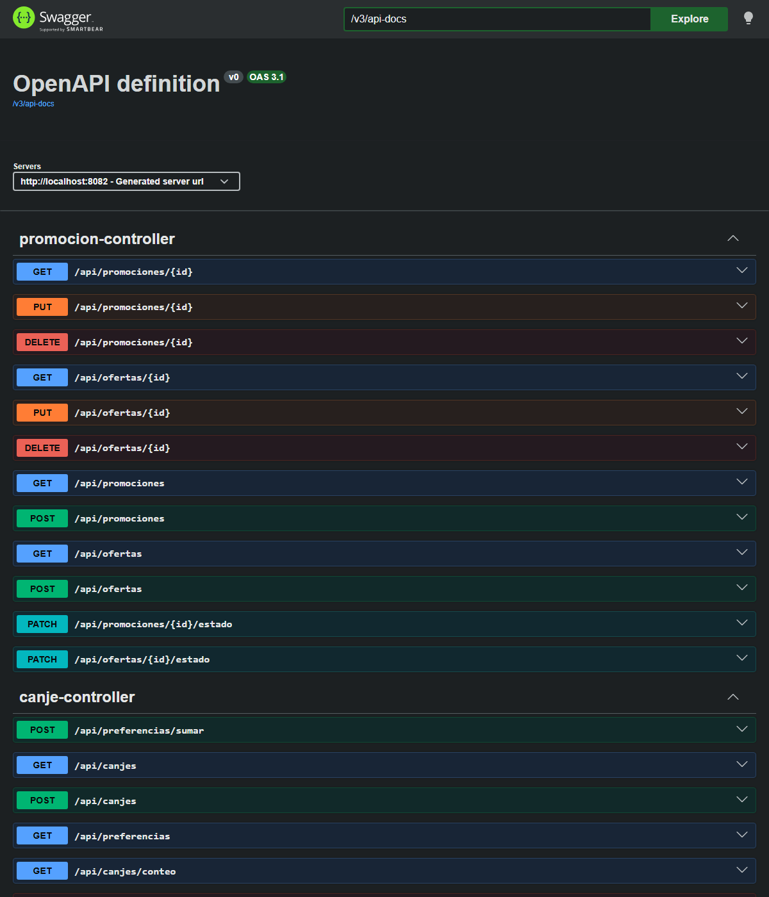
</p>

## Pruebas unitarias

Hay 88 pruebas unitarias en [`app/src/test`](app/src/test/java/cl/dsy1105/cocinacapital) y pasan todas. Usan JUnit 4, MockK para simular la base de datos y las APIs, y kotlinx-coroutines-test para el código asíncrono.

| Archivo | Pruebas | Qué revisa |
|---|---|---|
| `AppStateTest` | 38 | Login, registro, roles, canje, promociones del local y sincronización con el servidor |
| `RecomendadorTest` | 9 | Filtros y puntaje del % de match |
| `FechasTest` | 9 | Días y horas disponibles al armar una salida |
| `ClimaTest` | 8 | Traducción de la respuesta de Open-Meteo |
| `ValidacionesTest` | 7 | Correo, contraseña y datos de una promoción |
| `PromocionProgramadaTest` | 6 | Fechas de inicio y término de las promociones |
| `ClimaViewModelTest` | 6 | Estados de la tarjeta del clima y cuándo se vuelve a consultar |
| `RemotoTest` | 5 | Respuestas del servidor: éxito, errores y falta de conexión |

La cobertura se mide con Jacoco sobre la lógica de la app (datos, conexión remota, utilidades y ViewModel): 92 % de instrucciones y 80 % de ramas.

```
./gradlew testDebugUnitTest
./gradlew jacocoLogica
```

En Windows se usa `gradlew.bat` en vez de `./gradlew`. Los reportes quedan en `app/build/reports/tests/testDebugUnitTest/index.html` y `app/build/reports/jacoco/jacocoLogica/html/index.html`.

<p>
  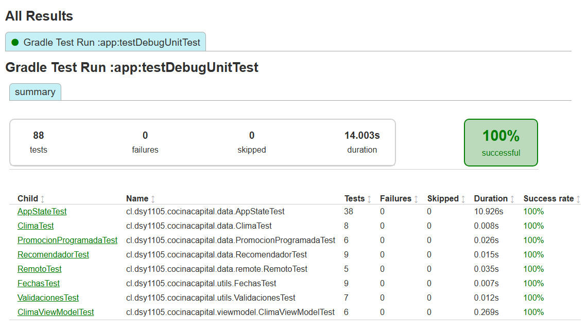
</p>
<p>
  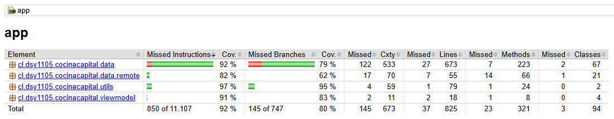
</p>

## APK firmado (release)

| Archivo | Qué es |
|---|---|
| [`entrega/CocinaCapital-1.0-release.apk`](entrega/CocinaCapital-1.0-release.apk) | APK firmado, listo para instalar |
| [`entrega/CocinaCapital-1.0-release.aab`](entrega/CocinaCapital-1.0-release.aab) | Android App Bundle firmado, el formato que pide Google Play |
| [`keystore/cocinacapital.jks`](keystore/cocinacapital.jks) | Llave con la que se firmó |
| [`keystore.properties`](keystore.properties) | Ruta de la llave, alias y contraseñas |

La firma está configurada en [`app/build.gradle.kts`](app/build.gradle.kts), en el bloque `signingConfigs`. Ese bloque lee `keystore.properties` y lo usa en la variante `release`. Para generar de nuevo el APK y el AAB firmados:

```
./gradlew assembleRelease
./gradlew bundleRelease
```

## Cómo ejecutar el proyecto

Se necesita Android Studio reciente (trae Java 17 y el emulador) y un emulador con Android 7.0 o más nuevo.

1. Levantar los microservicios, cada uno en su propia consola:

   ```
   cd backend/usuarios
   mvnw spring-boot:run
   ```

   ```
   cd backend/promociones
   mvnw spring-boot:run
   ```

   Al partir por primera vez cargan solos los datos de prueba.

2. Abrir la carpeta del proyecto en Android Studio, esperar que Gradle sincronice y ejecutar la app en el emulador. También se puede instalar directamente el APK firmado arrastrándolo sobre el emulador.

3. Revisar el backend:
   - Swagger: http://localhost:8081/swagger-ui.html y http://localhost:8082/swagger-ui.html
   - Consola H2: http://localhost:8081/h2-console y http://localhost:8082/h2-console (JDBC URL `jdbc:h2:file:./data/usuarios` o `jdbc:h2:file:./data/promociones`, usuario `sa`, sin contraseña)

Cuentas de prueba (datos ficticios):

| Rol | Correo | Contraseña |
|---|---|---|
| Comprador | `demo@correo.cl` | `demo1234` |
| Local | `trattoria@correo.cl` | `trattoria123` |
| Administrador | `admin@correo.cl` | `admin1234` |

## Tecnologías

| App Android | Versión |
|---|---|
| Kotlin | 2.2.10 |
| Jetpack Compose (BOM) y Material 3 | 2026.02.01 |
| Navigation Compose | 2.10.1 |
| Room | 2.8.0 |
| Retrofit + Gson + OkHttp | 2.11.0 |
| ZXing (código QR del voucher) | 3.5.3 |
| Android Gradle Plugin / Gradle | 9.3.3 / 9.7.1 |
| minSdk / targetSdk | 24 / 36 |

| Backend | Versión |
|---|---|
| Spring Boot (Web, Data JPA, Validation) | 4.1.2 |
| Java | 17 o más nuevo |
| H2 Database | la que trae Spring Boot |
| springdoc-openapi (Swagger) | 3.2.0 |
| Spring Security Crypto (BCrypt) | la que trae Spring Boot |

| Pruebas | Versión |
|---|---|
| JUnit | 4.13.2 |
| MockK | 1.14.5 |
| kotlinx-coroutines-test | 1.9.0 |
| Jacoco | 0.8.14 |

## Estructura del código

```
app/src/main/java/cl/dsy1105/cocinacapital/
├── data/              Estado de la app, recomendador, clima y datos de ejemplo
│   ├── room/          Entidades y DAOs de Room
│   └── remote/        Interfaces Retrofit (microservicios y Open-Meteo)
├── viewmodel/         ClimaViewModel
├── navigation/        Rutas entre pantallas
├── ui/
│   ├── views/         Pantallas (login, inicio, armar salida, detalle, vouchers, perfil, local, admin)
│   ├── components/    Componentes reutilizables (tarjeta del clima, barras de horas, calendario)
│   └── theme/         Colores, tipografía y tema Material 3
└── utils/             Validaciones, fechas y foto de perfil

backend/
├── usuarios/          Microservicio de usuarios (controller, service, repository, entity, dto)
└── promociones/       Microservicio de promociones (misma estructura)
```

## Capturas

| Inicio | Promociones | Arma tu salida |
|---|---|---|
|  | 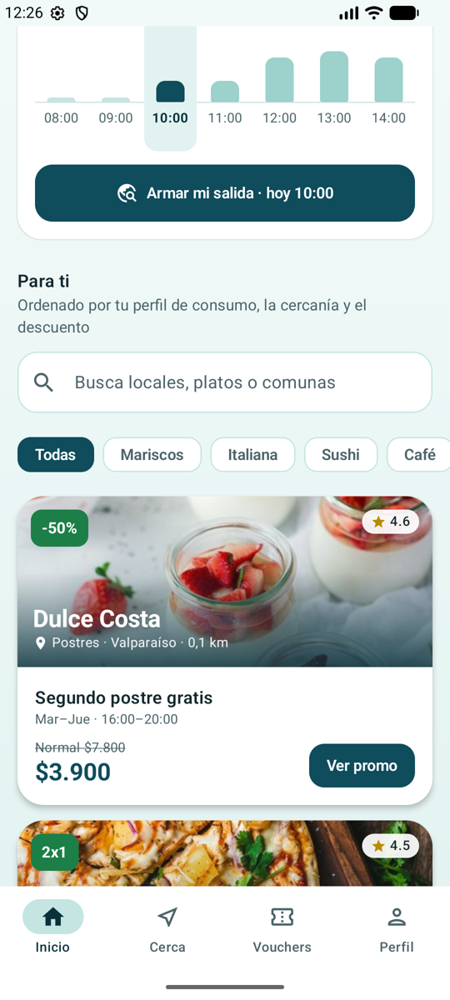 | 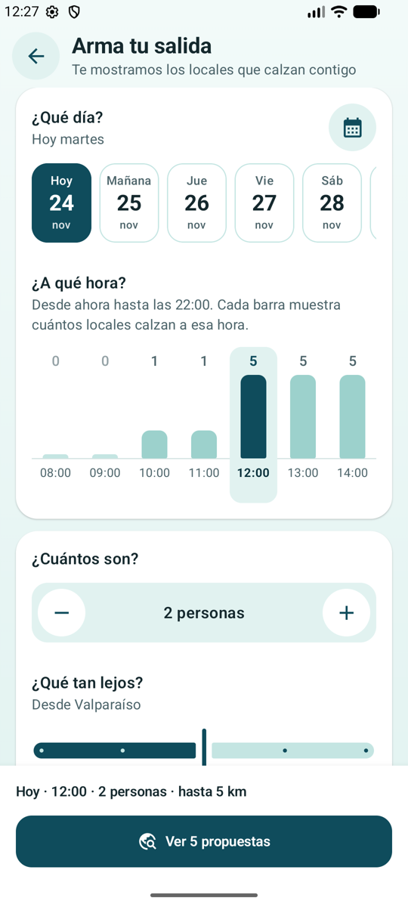 |

| Propuestas con % de match | Detalle | Voucher |
|---|---|---|
|  | 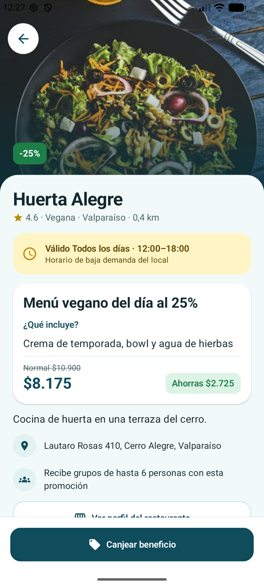 |  |

| Perfil del comprador | Panel del local | Promociones del local |
|---|---|---|
| 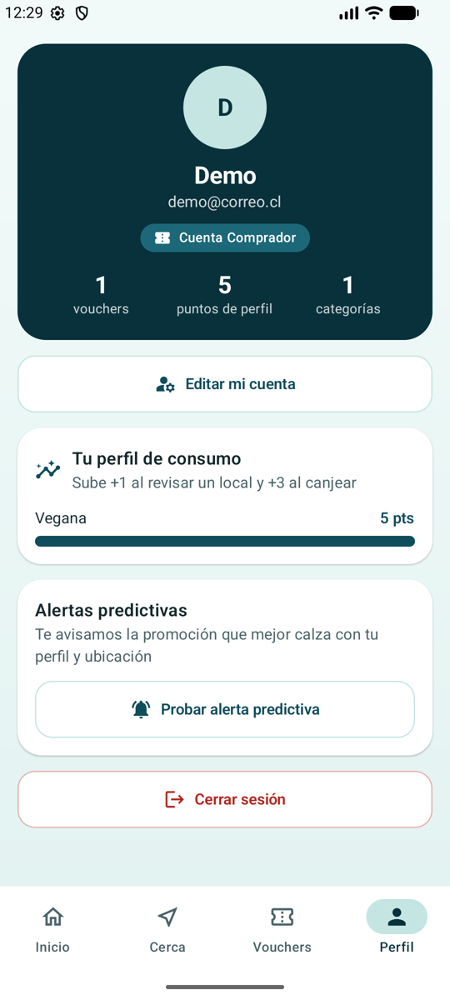 | 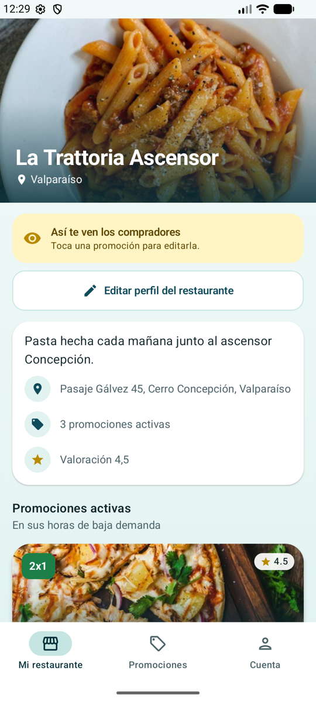 | 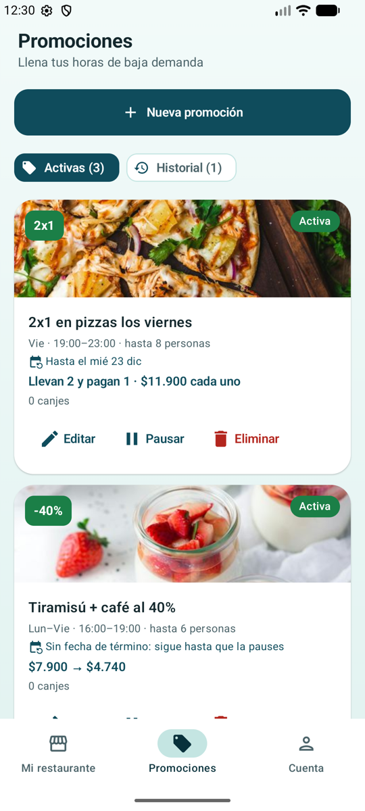 |

| Administrador | Login |
|---|---|
| 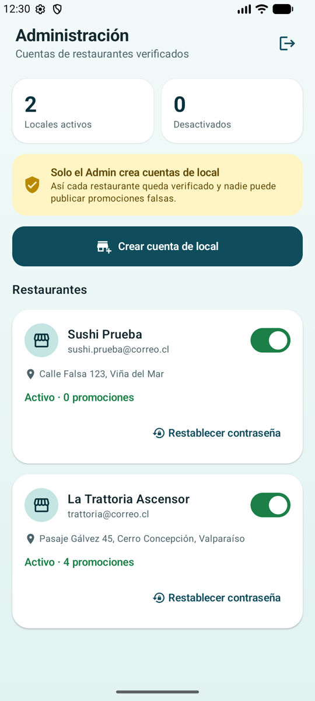 |  |

Las fotos de comida son de licencia libre (Unsplash y Pexels). El detalle está en [`FOTOS_ORIGEN.txt`](FOTOS_ORIGEN.txt).
